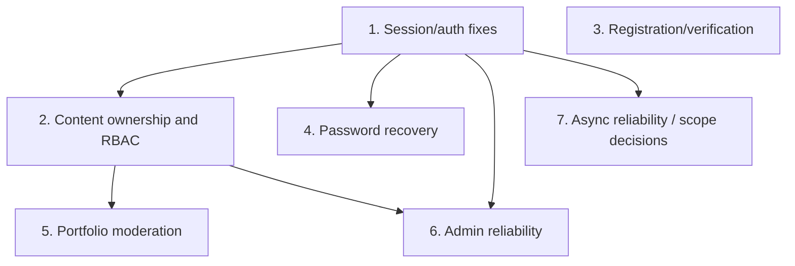

# SNPL PORT State-Machine Refactoring Roadmap

## Purpose and approval gate

This dependency-aware roadmap implements the evidence-based findings in the inventory, transition analysis, and security audit. It is a proposal only. Per the requested workflow, **no application code is to be changed until the owner explicitly approves this roadmap and any listed behavior decisions.**

Priority follows security and preservation constraints. Priority order has been adjusted from the generic ordering because current session revocation and ownership controls have directly evidenced security gaps.

## Priority 1 — Authentication and session management

- **Current implementation:** JWT includes a session ID; MongoDB persists `active` and `expiresAt`; middleware verifies JWT and looks up a session/user; logout accepts request-provided email/session ID; frontend persists token/user/session ID in local storage and uses 20-minute inactivity timeout.
- **Problems:** SEC-01 revoked/expired DB state not checked; SEC-03 unauthenticated email-driven revocation; timeout causes duplicate cleanup; infrastructure errors are conflated with 401.
- **Proposed changes:** enforce active and future-expiring session in middleware; derive current logout target from authenticated session; require authenticated principal for logout-all; consolidate expiration cleanup; preserve response formats where practical.
- **Files likely affected:** `backend/src/services/session.service.js`, `backend/src/repositories/session.repository.js`, `backend/src/middleware/session.middleware.js`, `backend/src/routes/user.route.js`, `backend/src/controllers/user.controller.js`, `backend/src/services/user.service.js`, `frontend/myfullstack/src/services/authService.ts`, `src/hooks/useAuth.ts`, `src/hooks/useSessionTimeout.ts`.
- **Dependencies:** clarify compatibility for logout route/body, ensure existing sessions have required fields; no schema change expected.
- **Tests:** SM-01/03 test matrix; especially still-valid JWT after revocation, expired/inactive sessions, cross-user logout, logout-all, DB outage.
- **Regression risks:** existing clients may depend on logout without Bearer token or body-based email/session ID; implement coordinated client/server transition and preserve local sign-out on network failure.
- **Acceptance:** active sessions work; revoked/expired sessions fail next request; only owner can revoke; logout-one/all works for current user; standard auth response contracts remain stable.

## Priority 2 — Post/event ownership and role-based authorization

- **Current implementation:** role middleware protects create/update/delete routes, but services accept body-provided author; post update has no owner guard; post/event delete compares body username; admin review routes are role-protected.
- **Problems:** SEC-02, SEC-04, SEC-05: authorship can be spoofed, other users' content can be updated/deleted, update payload includes sensitive fields.
- **Proposed changes:** pass authenticated principal into services; derive author from principal; enforce owner-or-admin guard; use update allowlists; preserve admin-only review operations. Resolve legacy ownership mapping before changing rules for old records.
- **Files likely affected:** `backend/src/routes/post.route.js`, `src/routes/eventpost.route.js`, `src/controllers/post.controller.js`, `src/controllers/eventpost.controller.js`, `src/services/post.service.js`, `src/services/eventpost.service.js`, possibly repositories and models only if an approved migration is necessary; frontend create/delete handlers in `frontend/myfullstack/src/App.tsx`.
- **Dependencies:** explicit decision about legacy `author` string mapping; no silent schema/data migration.
- **Tests:** owner/non-owner/admin matrices, forged author and protected-field payloads, public reads, deletion behavior.
- **Regression risks:** old posts/events may not have a resolvable user ID; admin override semantics must be explicit.
- **Acceptance:** non-owner cannot mutate content even with a forged body; valid owners/admins retain approved actions; old records remain visible and are handled by agreed compatibility logic.

## Priority 3 — Registration and account verification

- **Current implementation:** user registration creates unverified account and emails token; email-send failure deletes the account; verification token is single-use by clearing it; no expiry is modeled; login requires verified status.
- **Problems:** verification never expires in inspected code; email-failure compensating delete has unapproved persistence semantics; no resend transition evidenced.
- **Proposed changes:** after decisions, optionally add backward-compatible verification expiry and explicit resend flow; test registration side effects. Do not change email-failure deletion behavior until retention/retry policy is decided.
- **Files likely affected:** `backend/src/services/user.service.js`, `src/models/user.model.js`, `src/repositories/user.repository.js`, `src/controllers/user.controller.js`, `src/routes/user.route.js`, email configuration, relevant frontend auth view.
- **Dependencies:** approval of expiry duration, repeated verification behavior, resend policy, and delivery failure handling. Any schema change needs migration/legacy interpretation.
- **Tests:** duplicate/concurrent signup; valid/invalid/expired/repeated verify; email success/failure; login before/after verification.
- **Regression risks:** existing pending accounts with tokens but no expiry; email delivery and registration API contract.
- **Acceptance:** approved lifecycle is explicit; existing accounts remain compatible; no account deletion or migration behavior changes without consent.

## Priority 4 — Password recovery and session invalidation

- **Current implementation:** random reset token is stored hashed with a 15-minute expiry; repository query matches hash only; reset updates password/clears reset values; existing sessions remain active; forgot-password generic response and limiter exist.
- **Problems:** SEC-06 expiry not enforced; SEC-08 existing sessions survive password reset; email failure leaves reset token persisted.
- **Proposed changes:** enforce reset expiry in repository/service; retain single-use hash semantics and generic email response; decide whether successful reset revokes all access sessions; define failed delivery token handling.
- **Files likely affected:** `backend/src/services/auth.service.js`, `backend/src/repositories/user.repository.js`, `backend/src/models/user.model.js` (only if needed), `backend/src/services/session.service.js`, `frontend/myfullstack/src/components/ForgotPasswordPage.tsx` and `ResetPasswordPage.tsx` only if response behavior changes.
- **Dependencies:** session Priority 1 for effective revocation; policy confirmation for global sign-out and email failure semantics.
- **Tests:** valid/expired/missing/replaced/consumed reset token; password hash and session state; known/unknown email response equality; delivery failure.
- **Regression risks:** older records with null reset expiry; recovery page assumes current messages and redirects after success.
- **Acceptance:** expired token cannot reset password; valid token is single-use; chosen session policy works; account-enumeration response remains generic.

## Priority 5 — Portfolio lifecycle and moderation

- **Current implementation:** posts default approved; reported/reason/status fields exist; admin can list/review/soft-remove; public query excludes removed; owner delete is physical.
- **Problems:** ownership/update gaps covered in Priority 2; allowed moderation transitions and `pending` semantics are undocumented; physical deletion and soft removal differ.
- **Proposed changes:** specify status transition table; enforce admin-only moderation and field allowlists; preserve existing default and removal/list behavior unless separately approved.
- **Files likely affected:** post service/controller/route/model/repository, admin dashboard, feed components, audit service if approved.
- **Dependencies:** Priority 2 ownership; product decision on pending/default and physical-vs-soft delete; audit policy.
- **Tests:** all status transitions, ordinary user cannot moderate, removed posts excluded, admin review survives reload, owner deletion as intended.
- **Regression risks:** changing default or delete semantics impacts public visibility and retained data.
- **Acceptance:** only approved transitions persist; no moderation field can be changed through normal user updates; current content remains discoverable according to existing policy.

## Priority 6 — Administrative operations and auditability

- **Current implementation:** admin role is loaded from DB in auth middleware; admin route middleware protects backend operations; dashboard client checks stored role, loads stats/users/reports, applies optimistic list updates, and audit logs are separate.
- **Problems:** shared loading/error state and uncancelled search can show stale results; audit/mutation failures may leave UI and persisted data mismatched. SEC-10.
- **Proposed changes:** independent resource/mutation statuses, stale-search protection, response validation/rollback; maintain backend authorization and audit semantics.
- **Files likely affected:** `frontend/myfullstack/src/components/AdminDashboard.tsx`, admin-related services/controllers, `backend/src/middleware/authorize.middleware.js` only if tests reveal a guard issue.
- **Dependencies:** backend role/session guard fixes; confirm audit log requirements.
- **Tests:** non-admin denial, DB role change reflected on next request, partial resource failure, search race, mutation failure and rollback.
- **Regression risks:** visual loading/partial-data behavior changes; must retain all dashboard tabs and operations.
- **Acceptance:** server rejects non-admin transitions; stale requests do not overwrite current results; failed writes are not presented as success.

## Priority 7 — Comments, notifications, and asynchronous operations

- **Current implementation:** no comment model/route was found. Registration and reset email sends are synchronous; no background queue/retry state was found. Feed/admin fetch errors use inconsistent status presentation.
- **Problems:** high-level brief names features not evidenced in source; email partial failure differs; community errors can appear empty; duplicate/retry semantics are unspecified.
- **Proposed changes:** first confirm whether comments are in scope; do not build absent features. For existing flows, separate loading/error/empty states, define retry/idempotency and email delivery policy before considering background work.
- **Files likely affected:** if approved, existing feed/recovery/admin frontend components and related services; adding comments/queue infrastructure would require a separate scoped design and approval.
- **Dependencies:** product approval and current framework/database constraints. No new framework, queue, or dependency is proposed here.
- **Tests:** request failure/empty distinction, duplicate requests, retry after provider/DB failure, response ordering.
- **Regression risks:** retrying email can create multiple tokens/emails; adding infrastructure increases operational complexity.
- **Acceptance:** only currently supported features are altered; async failures are visible and recoverable; no duplicate/destructive side effects.

## Dependency map

Priority 3 and Priority 1 can be implemented independently after approval, but this roadmap orders session fixes first because of verified revocation impact. Priorities 5–7 must not bypass ownership/role controls.

## Required human decisions before implementation

1. Approve this roadmap and proceed one priority at a time.
2. Confirm logout API compatibility and logout-all behavior.
3. Confirm policy for old content with username-only `author` records.
4. Confirm whether self-service profile deletion is intended.
5. Confirm reset-password session invalidation policy.
6. Confirm verification expiration/resend and failed-email retention policy.
7. Confirm whether comments or notification queues are actually in scope.

No implementation begins until explicit approval is given.
