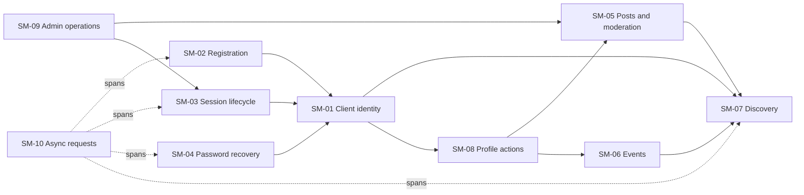

# SNPL PORT State Machine Inventory

## Scope and method

This inventory consolidates the earlier state-machine discovery and verifies it against the current frontend and backend source. These machines are implicit: most are encoded as independent React state variables, conditionals, HTTP handlers, and MongoDB fields rather than declared statecharts or reducers.

The inventory describes observed code, not a claim that every transition is correct or desired. Security and behavior gaps are analyzed separately in [STATE_TRANSITION_ANALYSIS.md](./STATE_TRANSITION_ANALYSIS.md) and [../security/STATE_MACHINE_SECURITY_AUDIT.md](../security/STATE_MACHINE_SECURITY_AUDIT.md).

## Inventory

| ID | State machine / purpose | Frontend files | Backend files | Persisted state / external services |
|---|---|---|---|---|
| SM-01 | Client identity and access: choose signed-out, guest, or signed-in experience; submit login and logout | `frontend/myfullstack/src/App.tsx`, `src/hooks/useAuth.ts`, `src/services/sessionManager.ts`, `src/services/authService.ts`, `src/components/AuthView.tsx`, `src/components/ProfileDrawer.tsx` | `backend/src/routes/user.route.js`, `src/controllers/user.controller.js`, `src/services/user.service.js`, `src/middleware/session.middleware.js` | `localStorage` user/token/session ID; `User` and `Session` documents |
| SM-02 | Account registration and email verification | `frontend/myfullstack/src/App.tsx`, `src/components/AuthView.tsx` | `backend/src/routes/user.route.js`, `src/controllers/user.controller.js`, `src/services/user.service.js`, `src/config/email.js`, `src/models/user.model.js` | `User.verified`, `User.verificationToken`; verification email provider |
| SM-03 | Access-session lifecycle: create, authenticate, revoke, expire, suspend | `frontend/myfullstack/src/hooks/useSessionTimeout.ts`, `src/services/sessionManager.ts`, `src/services/authService.ts` | `backend/src/utils/auth.js`, `src/services/session.service.js`, `src/repositories/session.repository.js`, `src/middleware/session.middleware.js`, `src/models/session.model.js` | JWT `exp`/`jti`; `Session.active`, `revokedAt`, `expiresAt`; MongoDB TTL index |
| SM-04 | Password recovery: request reset, validate token, set new password | `frontend/myfullstack/src/components/ForgotPasswordPage.tsx`, `src/components/ResetPasswordPage.tsx` | `backend/src/routes/auth.route.js`, `src/controllers/auth.controller.js`, `src/services/auth.service.js`, `src/repositories/user.repository.js`, `src/models/user.model.js`, `src/config/email.js` | Hashed reset token and expiry on `User`; reset email provider |
| SM-05 | Project/post lifecycle and moderation | `frontend/myfullstack/src/App.tsx`, `src/components/Feed.tsx`, `src/components/ProfileDrawer.tsx`, `src/components/AdminDashboard.tsx` | `backend/src/routes/post.route.js`, `src/controllers/post.controller.js`, `src/services/post.service.js`, `src/repositories/post.repository.js`, `src/models/post.model.js` | `Post` content, string `author`, `reported`, `reportReason`, `moderationStatus` |
| SM-06 | Event lifecycle | `frontend/myfullstack/src/App.tsx`, `src/components/EventFeed.tsx`, `src/components/ProfileDrawer.tsx` | `backend/src/routes/eventpost.route.js`, `src/controllers/eventpost.controller.js`, `src/services/eventpost.service.js`, `src/repositories/eventpost.repository.js`, `src/models/eventpost.model.js` | `EventPost` content and string `author` |
| SM-07 | Community discovery view: projects/events, list/grid, search, pagination, refresh | `frontend/myfullstack/src/App.tsx`, `src/components/Header.tsx`, `src/components/Feed.tsx`, `src/components/EventFeed.tsx` | `backend/src/services/post.service.js`, `src/services/eventpost.service.js`, their repositories and routes | In-memory React state; paginated database reads |
| SM-08 | Profile drawer and account actions | `frontend/myfullstack/src/App.tsx`, `src/components/ProfileDrawer.tsx`, `src/services/authService.ts` | `backend/src/routes/user.route.js`, `src/controllers/user.controller.js`, `src/services/user.service.js` | Drawer/form React state; user/session documents |
| SM-09 | Admin dashboard loading, tab selection, and user/content operations | `frontend/myfullstack/src/components/AdminDashboard.tsx`, `src/App.tsx` | `backend/src/middleware/authorize.middleware.js`, user/post routes, controllers, services and repositories | Stored client user for route presentation; backend role from DB; user/post/audit data |
| SM-10 | Async request and feedback lifecycle (loading, success, failure, empty results, retry) | `frontend/myfullstack/src/App.tsx`, `src/components/ForgotPasswordPage.tsx`, `src/components/ResetPasswordPage.tsx`, `src/components/AdminDashboard.tsx` | Controllers/services/repositories for each corresponding operation | Component-local booleans/messages/data; network, MongoDB, and email provider outcomes |

### Machines not evidenced in current source

- The provided scope mentions comments and interactions, but the inspected frontend/backend source contains no comment model, comment routes, or interaction lifecycle. Do not design or implement one based only on the high-level prompt.
- No standalone notification-delivery state or background job/retry state is apparent. Registration and password-reset email calls are awaited inline in services.
- No explicit email-verification expiry field or expiry check was found; do not describe verification links as expiring.

## Machine details

### SM-01 — Client identity and access

- **Initial state:** `useAuth` reads `snpl_user` and `snpl_token` from local storage; `AppShell` initializes `isGuest=false` and `mode="login"`.
- **States represented:** signed out, login form, signup form, request pending, guest browsing, authenticated, session-expired/message state.
- **Triggers:** login/signup form submission, successful or failed API response, guest action, sign-in from guest header, logout, auth-state-changed browser event, API 401, inactivity timeout.
- **Guards:** login/signup route selected by `mode`; client UI chooses authenticated/guest/auth view based on `user` and `isGuest`; API middleware validates bearer token for requests that supply one.
- **Side effects:** writes/removes local storage, dispatches `auth:state-changed`, calls logout endpoint, navigates to `/` on sign-out.
- **Dependencies:** SM-02 for verified registration; SM-03 for protected request/session validity.
- **Observed relationship:** `user`, `token`, and `isGuest` are independent values; persisted auth is not represented as one atomic state.

### SM-02 — Registration and verification

- **Initial state:** no account.
- **States represented:** unregistered, pending verification, verified, registration/verification error.
- **Triggers:** register endpoint, email provider outcome, verification URL request.
- **Guards:** required fields; normalized email uniqueness lookup; verification token lookup.
- **Side effects:** creates a user, sends a verification email, removes the newly created user if email delivery fails, marks a matching user verified and clears the token.
- **Dependencies:** SM-01 login requires verification; SM-10 captures request and email errors.
- **Persistence:** `verified` and `verificationToken`; no verification expiry field is present in `User`.

### SM-03 — Access-session lifecycle

- **Initial state:** no session.
- **States represented:** active session, revoked session, expired JWT/session, suspended account, missing/invalid session.
- **Triggers:** successful verified login, API request, logout-one, logout-all, expiration/TTL cleanup, admin suspension.
- **Guards:** JWT verification; session lookup; user lookup; suspended check.
- **Side effects:** creates/revokes `Session`; signs JWT with session ID in `jti`; attaches current database role/profile to `req.user`.
- **Dependencies:** SM-01 client persistence; SM-09 admin suspension/role operations.
- **Persistence:** JWT expiry plus `Session.active`, `revokedAt`, and `expiresAt`.
- **Caution:** the source uses `getActiveSession`, but its repository lookup does not filter active or expiry state. The diagram’s intended revoked/expired behavior therefore differs from the observed guard.

### SM-04 — Password recovery

- **Initial state:** no active recovery request.
- **States represented:** request form, sending, generic request success, request error; reset form, resetting, reset success, reset error.
- **Triggers:** request reset email; open reset URL; submit new password; 1.2-second post-success redirect.
- **Guards:** email regex; nonempty reset token; password length at least six; confirmation match; reset-token lookup.
- **Side effects:** generate random token, persist SHA-256 token and expiry, send email, update password (bcrypt hook on save), clear reset fields.
- **Dependencies:** SM-10; after reset, subsequent login uses SM-01/SM-03.
- **Caution:** reset lookup matches the hash only; expiry enforcement is not present in the repository query.

### SM-05 — Project/post lifecycle and moderation

- **Initial state:** no post.
- **States represented:** created/approved (model default), reported/unreported, pending/approved/removed moderation status, updated, deleted.
- **Triggers:** create, public list, admin list reports, admin review, update, owner-delete, admin soft-remove.
- **Guards:** route-level roles for create and admin operations; delete service compares a body-provided username against string `author`.
- **Side effects:** creates or changes `Post`; owner delete physically deletes; admin-delete marks removed and reported.
- **Dependencies:** SM-07 displays public posts; SM-08 submits creations; SM-09 moderation.
- **Persistence:** `Post` schema includes string author and moderation fields; no immutable owner user ID is present in the inspected model.

### SM-06 — Event lifecycle

- **Initial state:** no event.
- **States represented:** published, visible in paginated list, deleted.
- **Triggers:** create, list, delete.
- **Guards:** route roles for create/delete; delete service compares body-provided username to string `author`.
- **Side effects:** create/delete event document.
- **Dependencies:** SM-07 list/search; SM-08 create form.
- **Persistence:** `EventPost` document with string `author`; no explicit moderation or lifecycle status.

### SM-07 — Community discovery view

- **Initial state:** project feed, list layout, page 1, empty search.
- **States represented:** projects/events; list/grid; search open/closed and term/scope; first/subsequent page; refreshing/idle; empty/populated/error-cleared display.
- **Triggers:** nav or search-scope change, layout button, search input, load more, mount/user change, pull-to-refresh.
- **Guards:** selected feed; `hasMorePosts`/`hasMoreEvents`; pull distance over 90 pixels.
- **Side effects:** fetch public paginated data; append or replace items; update page/has-next flags; scroll to top.
- **Dependencies:** SM-05, SM-06, SM-10.
- **Caution:** `searchScope` and `activeFeed` are separate states; bottom navigation updates only `activeFeed`.

### SM-08 — Profile drawer and account actions

- **Initial state:** closed; empty project/event forms.
- **States represented:** closed/open; project/event form selected by feed; form input; publish success/error; logout one/all; delete-profile confirmation and outcome.
- **Triggers:** profile button, overlay/close, feed change, form submit, logout controls, delete control.
- **Guards:** UI visibility depends on signed-in `user`; handlers also return if no `user`; logout-all/delete use browser confirmation.
- **Side effects:** API calls, post/event refresh, auth cleanup.
- **Dependencies:** SM-01, SM-03, SM-05, SM-06, SM-09.
- **Caution:** profile deletion UI calls the delete route with email; backend route is admin-only. No schema/data change is proposed before product intent is confirmed.

### SM-09 — Admin dashboard

- **Initial state:** overview tab, loading true, empty collections.
- **States represented:** checking local role/token, redirect, loading, loaded stats/users/reports, selected overview/users/reports/audit tab, audit-loading, error.
- **Triggers:** route entry, query search (debounced), tab selection, audit log request, admin actions.
- **Guards:** frontend redirects unless locally stored role is admin; API admin routes independently require `authorize("admin")`.
- **Side effects:** fetch stats/users/reports, update client lists after mutations, suspend/reactivate user, change role, delete user, review/remove post, fetch audit logs.
- **Dependencies:** SM-03 server-derived role; SM-05 moderation.
- **Caution:** several independent requests update one `loading` and one `error`; latest response is not explicitly coordinated when search changes quickly.

### SM-10 — Async request and feedback lifecycle

- **Initial state:** idle or page-specific initial loading.
- **States represented:** idle, pending, success, failure, empty result; some actions also have pagination-in-progress.
- **Triggers:** user submission/navigation, component mount, retry, timeout.
- **Guards:** response status and expected response shape; per-flow client validation.
- **Side effects:** network calls to Express, MongoDB operations, synchronous email sends, local UI messages.
- **Dependencies:** all other machines.
- **Caution:** the representation is not uniform: some errors are logged and hidden (feed fetch), some are displayed, and some state is cleared even if a remote logout fails.

## Cross-machine dependencies

## System boundaries

- **Frontend:** React 19, TypeScript, React Router, Vitest/Testing Library, Framer Motion. State is component-local `useState`; no state-machine library or app-wide reducer is evident.
- **Backend:** Express, service/repository split, Mongoose models, JWT, bcrypt, `express-rate-limit`.
- **External dependencies:** MongoDB Atlas; verification and reset email provider; Render/Netlify deployment configuration.
- **Persistence:** MongoDB `User`, `Session`, `Post`, `EventPost` and audit models; browser local storage for client auth state.
- **No data changes are proposed in this audit phase.**
